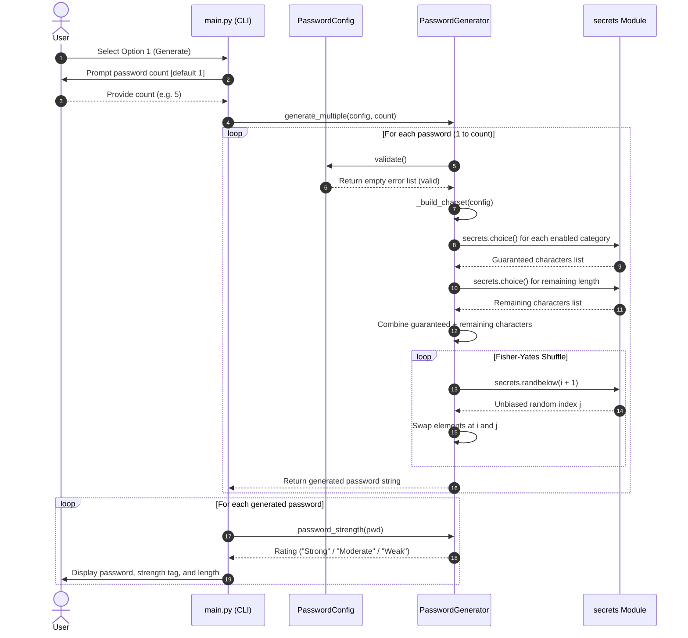

# Architecture Document — Task 01: Password Generator

## 1. Project Architecture Overview
The Password Generator application follows a clean, decoupled **Two-Layer Architecture** separating core domain logic from the user presentation layer:

1. **Presentation Layer (CLI Interface)**: Handles terminal I/O, user prompting, input coercion, visual formatting, menu dispatch, and error presentation.
2. **Domain/Service Layer (Core Generator Engine)**: Houses business logic, configuration schema definitions, validation rules, cryptographically secure character selection, shuffling algorithms, and password strength evaluation.

This separation ensures that the core generator is completely independent of the command line interface, enabling straightforward reusability in GUI, web, or API environments, as well as friction-free unit testing.

```
+------------------------------------------------------------------------+
|                          Presentation Layer                            |
|                               (main.py)                                |
|  - Banner & Menu Dispatcher         - Interactive Settings Editor      |
|  - Input Readers (read_int, etc.)   - Formatted Output Display         |
+------------------------------------------------------------------------+
                                    |
                                    v (invokes & configures)
+------------------------------------------------------------------------+
|                             Domain Layer                               |
|                         (src/generator.py)                             |
|  +----------------------+  +---------------------+  +----------------+ |
|  |    PasswordConfig    |  |  PasswordGenerator  |  |password_strength|
|  | - length: 4-128      |  | - _build_charset()  |  | - Weak         | |
|  | - character toggles  |  | - _guaranteed_chars |  | - Moderate     | |
|  | - validate() -> List |  | - generate()        |  | - Strong       | |
|  +----------------------+  | - generate_multiple |  +----------------+ |
|                            +---------------------+                     |
|                                       |                                |
|                                       v (relies upon)                  |
|                         Python Standard Library                        |
|                     (secrets, string, dataclasses)                     |
+------------------------------------------------------------------------+
```

---

## 2. Folder and Module Responsibilities

The codebase is organized with clear modular boundaries:

```
Task_01_Password_Generator/
├── main.py                 # CLI application entry point and presentation layer
├── src/
│   ├── __init__.py         # Package initialization marker
│   └── generator.py        # Core domain logic, models, algorithms, and evaluation
├── tests/
│   └── test_generator.py   # Comprehensive automated unit test suite (36 tests)
├── PRD.md                  # Product Requirements Document
├── ARCHITECTURE.md         # System Architecture & Design Details
├── RULES.md                # Development Rules & Coding Standards
├── DESIGN.md               # User Interface & Interaction Specification
├── TASKS.md                # Task Tracking & Implementation Status
├── MEMORY.md               # Development Context & History
└── README.md               # Project Readme and Quickstart Guide
```

### Module Breakdown
- **`main.py`**:
  - Serves as the top-level executable entry point.
  - Implements the interactive `while` menu loop (`main()`).
  - Provides robust input readers: `read_int()` with defaults and format guards, and `read_yes_no()` for binary choices.
  - Handles screen presentation: `BANNER`, `MENU`, `print_separator()`, `print_password_result()`, and `display_settings()`.
  - Coordinates generation workflows (`generate_passwords()`) and configuration modifications (`change_settings()`).
  - Configures terminal encoding via `sys.stdout.reconfigure(encoding="utf-8")` to support cross-platform Windows environments.

- **`src/generator.py`**:
  - Defines global constraints: `MIN_PASSWORD_LENGTH = 4`, `MAX_PASSWORD_LENGTH = 128`, `DEFAULT_PASSWORD_LENGTH = 16`.
  - Implements `PasswordConfig`: Dataclass holding configuration attributes and validation logic returning descriptive error strings.
  - Implements `PasswordGenerator`: Stateful-capable engine providing character pools (`UPPERCASE`, `LOWERCASE`, `DIGITS`, `SYMBOLS`), guaranteed category sampling, and Fisher-Yates shuffling.
  - Implements `password_strength()`: Evaluates string entropy based on length boundaries and character class counts.

- **`src/__init__.py`**:
  - Marks `src` as an importable Python package, exposing the core namespace.

- **`tests/test_generator.py`**:
  - Test suite with 36 test cases across 4 test classes (`TestPasswordConfig`, `TestPasswordGenerator`, `TestGenerateMultiple`, `TestPasswordStrength`).
  - Validates boundaries, error conditions, character category guarantees, statistical randomness, and strength grading.

---

## 3. Data Flow



---

## 4. Main Components

### 4.1 `PasswordConfig` (Dataclass)
```python
@dataclass
class PasswordConfig:
    length: int = DEFAULT_PASSWORD_LENGTH      # 16
    use_uppercase: bool = True
    use_lowercase: bool = True
    use_digits: bool = True
    use_symbols: bool = True
```
- **Responsibility**: Holds generator parameters and validates constraints.
- **Validation Rules**:
  - `length` must be an integer.
  - `length >= MIN_PASSWORD_LENGTH (4)`.
  - `length <= MAX_PASSWORD_LENGTH (128)`.
  - At least one of `use_uppercase`, `use_lowercase`, `use_digits`, or `use_symbols` must be `True`.
- **Return Type**: `List[str]` containing human-readable error descriptions.

### 4.2 `PasswordGenerator` (Class)
```python
class PasswordGenerator:
    UPPERCASE = string.ascii_uppercase   # 'ABCDEFGHIJKLMNOPQRSTUVWXYZ'
    LOWERCASE = string.ascii_lowercase   # 'abcdefghijklmnopqrstuvwxyz'
    DIGITS = string.digits               # '0123456789'
    SYMBOLS = string.punctuation         # '!"#$%&\'()*+,-./:;<=>?@[\\]^_`{|}~'
```
- **`generate(config: PasswordConfig) -> str`**: Validates config, selects guaranteed characters, selects remaining characters, applies Fisher-Yates shuffle, returns string.
- **`generate_multiple(config: PasswordConfig, count: int) -> List[str]`**: Validates count >= 1 and returns a list of passwords generated via `generate()`.

### 4.3 `password_strength(password: str) -> str` (Helper)
- **Heuristic**: Evaluates character length and unique pool representation:
  - Categories checked: Uppercase, Lowercase, Digits, Punctuation.
  - Returns `"Weak"` if length < 8 or categories <= 1.
  - Returns `"Strong"` if length >= 12 and categories >= 3.
  - Returns `"Moderate"` otherwise.

---

## 5. Dependencies
The project enforces a strict **Zero-External-Dependencies** constraint:
- **`secrets`**: Cryptographically secure pseudo-random number generator (CSPRNG) interface.
- **`string`**: Standard character constants (`ascii_uppercase`, `ascii_lowercase`, `digits`, `punctuation`).
- **`dataclasses`**: Structured configuration representation with `dataclass`.
- **`typing`**: Type hinting (`List`, `Optional`).
- **`sys` & `io`**: System-level stdout configuration for stream encoding resilience.
- **`unittest` & `os`**: Automated testing framework and path resolution.

Compatible with Python 3.10 and above.

---

## 6. Error Handling Strategy

The system utilizes a multi-tiered error handling and defensive input strategy:

```
[Layer 1: CLI Input Coercion]
        │   - Non-integer input in read_int() -> Caught, displays warning, reprompts
        │   - Invalid yes/no in read_yes_no() -> Caught, displays warning, reprompts
        │   - Count > 100 in generate_passwords() -> Capped at 100 with warning
        v
[Layer 2: PasswordConfig Validation]
        │   - validate() checks types, bounds (4-128), and pool availability
        │   - Returns List[str] of all detected issues without throwing exceptions
        │   - CLI displays errors and reverts to previous valid configuration
        v
[Layer 3: PasswordGenerator Runtime Guards]
            - generate() calls config.validate(); raises ValueError if invalid
            - generate_multiple() validates count >= 1; raises ValueError if invalid
            - CLI catches ValueError and displays user-friendly error message
```

---

## 7. Security Architecture

1. **True Cryptographic Entropy**:
   - The application strictly avoids Python's standard `random` module (which implements the deterministic Mersenne Twister PRNG, vulnerable to state recovery after observing 624 outputs).
   - Random selection is executed exclusively through `secrets.choice()` and `secrets.randbelow()`, which interact directly with operating system entropy pools:
     - Linux/macOS: `getrandom()` / `/dev/urandom`
     - Windows: `BCryptGenRandom()`
2. **Guaranteed Entropy Distribution & Unbiased Shuffling**:
   - Rather than simple independent random picks (which might randomly omit required character classes), the generator ensures all selected categories are represented.
   - Guaranteed characters are shuffled together with general pool picks using the **Fisher-Yates (Knuth) shuffle**:
     ```python
     for i in range(len(password_chars) - 1, 0, -1):
         j = secrets.randbelow(i + 1)
         password_chars[i], password_chars[j] = password_chars[j], password_chars[i]
     ```
     This prevents bias in position placement (e.g., guaranteed uppercase character never always appearing at index 0).
3. **Secure Code Practices**:
   - No dynamic execution (`eval()`, `exec()`, `os.system()`).
   - No hardcoded seeds, secrets, or default passwords.
   - Session-only memory allocation; sensitive generated strings are not persisted to disk or log files.
