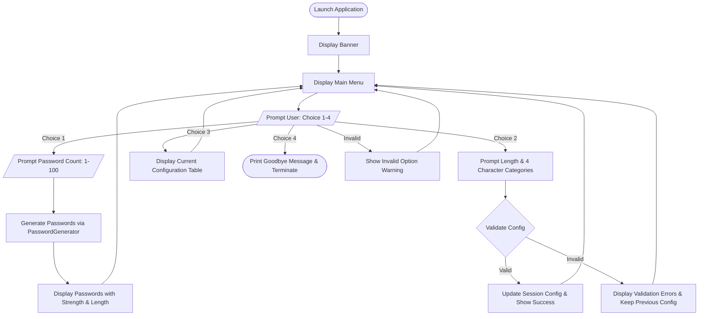

# Product Requirements Document (PRD) — Task 01: Password Generator

## 1. Product Overview
The **Secure Password Generator** is a command-line interface (CLI) application developed as part of the **Auspify Python Developer Internship (Task 1)**. It provides users with a reliable, cryptographically secure utility for generating high-entropy passwords tailored to arbitrary security policies and application requirements. Built exclusively with the Python standard library, it delivers zero-overhead deployment across diverse computing environments.

---

## 2. Problem Statement
In modern computing, password reuse and weak password patterns remain leading vectors for credential compromise, brute-force attacks, and credential stuffing. Users, system administrators, and developers frequently require randomized passwords that strictly comply with varying security criteria (e.g., minimum lengths, inclusion of uppercase letters, numbers, or symbols). Existing tools are often bloated, ad-ridden web utilities, require external dependencies, or rely on pseudo-random number generators (PRNGs) like Python's `random` module that are fundamentally insecure for cryptographic use. There is a need for a lightweight, transparent, and provably secure CLI password generator.

---

## 3. Target Users
- **Software Developers & Engineers**: Generating secure default credentials, secret keys, API tokens, and mock data.
- **System & Database Administrators**: Provisioning temporary passwords, SSH keys, database credentials, and service accounts.
- **Security-Conscious Individuals**: Creating strong master passwords and account credentials for personal or enterprise use.
- **Internship Evaluators / Reviewers**: Assessing software engineering standards, clean architecture, automated testing, and security hygiene.

---

## 4. Goals & Objectives
- **Cryptographic Security**: Utilize cryptographically secure pseudo-random number generation (CSPRNG) backed by OS-level entropy (`secrets` module).
- **Customizable Character Sets**: Enable granular toggling of uppercase (`A-Z`), lowercase (`a-z`), digits (`0-9`), and punctuation symbols (`!@#$%^&*...`).
- **Guaranteed Category Inclusion**: Ensure that every selected character type appears at least once in the generated output, eliminating edge-case policy rejections.
- **Batch Generation**: Support single and multi-password batch generation (up to 100 passwords per execution) for bulk provisioning.
- **Interactive User Experience**: Provide a clean, resilient, menu-driven CLI interface with in-session settings persistence and robust input validation.
- **Zero Dependencies**: Rely solely on the Python 3.10+ standard library for portability and friction-free execution.

---

## 5. Scope
### In Scope
- Interactive CLI application (`main.py`) with a 4-option text menu.
- Core generator engine (`src/generator.py`) containing the `PasswordConfig` dataclass, `PasswordGenerator` class, and `password_strength()` evaluator.
- Batch generation up to 100 passwords per run.
- Configurable password length between 4 and 128 characters.
- Evaluation and display of password strength (`[WEAK]`, `[MODERATE]`, `[STRONG]`).
- Automated unit test suite (`tests/test_generator.py`) with 36 test cases.
- Cross-platform ASCII-safe terminal presentation.

### Out of Scope
- Graphical User Interfaces (GUI / Web frontend).
- Persistent disk-based storage or database management (settings are session-scoped).
- Master password vaults or password management features (e.g., KeePass/1Password integrations).
- Direct clipboard manipulation or external OS keychain integrations.

---

## 6. Functional Requirements

| ID | Requirement Name | Description |
| :--- | :--- | :--- |
| **FR-1** | **Configurable Length** | The user can specify any password length from **4** to **128** characters inclusive. The default length is **16** characters. |
| **FR-2** | **Character Pool Selection** | The user can independently toggle four character categories: uppercase letters (`A-Z`), lowercase letters (`a-z`), decimal digits (`0-9`), and special symbols (`string.punctuation`). |
| **FR-3** | **Guaranteed Inclusion** | If a character category is enabled, the resulting password is guaranteed to include at least one character from that category. |
| **FR-4** | **Unbiased Shuffling** | Selected characters and pool fills are randomized using the Fisher-Yates shuffle algorithm driven by `secrets.randbelow()` to eliminate structural predictability. |
| **FR-5** | **Batch Generation** | Users can generate between **1** and **100** passwords in a single request. Values greater than 100 are automatically capped at 100 with user feedback. |
| **FR-6** | **Strength Evaluation** | Every generated password is rated as `Weak`, `Moderate`, or `Strong` based on length and character set diversity:  • **Weak**: Length < 8 OR ≤ 1 character category. • **Moderate**: Length 8–11 with ≥ 2 categories, OR length ≥ 12 with 1–2 categories. • **Strong**: Length ≥ 12 with ≥ 3 categories. |
| **FR-7** | **In-Session Persistence** | Modified configuration settings remain active throughout the current CLI session until manually updated or the program exits. |
| **FR-8** | **Input Validation & Recovery** | The system rejects invalid types, negative numbers, out-of-range lengths, and empty character pool selections without crashing, providing clear error prompts and maintaining previous valid states. |

---

## 7. Non-Functional Requirements

| ID | Category | Requirement Details |
| :--- | :--- | :--- |
| **NFR-1** | **Security** | All random selections must use Python's `secrets` module (`secrets.choice`, `secrets.randbelow`), which draws entropy from system cryptographic sources (`/dev/urandom` on Unix, `CryptGenRandom` / `BCryptGenRandom` on Windows). The insecure `random` module must never be imported. |
| **NFR-2** | **Portability** | Operates on Windows, macOS, and Linux on Python 3.10 or higher. Console output uses ASCII-safe box characters (`+`, `-`, `|`) with automatic UTF-8 fallback configuration (`sys.stdout.reconfigure(encoding="utf-8")`) for Windows `cp1252` compatibility. |
| **NFR-3** | **Dependencies** | Zero external dependencies (`pip` requirements empty). Standard library modules used: `secrets`, `string`, `dataclasses`, `typing`, `sys`, `io`, `unittest`, `os`. |
| **NFR-4** | **Performance** | Sub-second latency. Generating 100 passwords of maximum length (128 characters) must complete in under 50 milliseconds. |
| **NFR-5** | **Reliability & Testability** | Comprehensive test suite covering 100% of core generator branches. All 36 unit tests must pass cleanly. |
| **NFR-6** | **Usability** | Clear menu prompts, bracketed default values (`[16]`, `[Y/n]`), and unambiguous error messages. |

---

## 8. User Flow

---

## 9. Acceptance Criteria
- [x] **Test Suite**: All 36 unit tests in `tests/test_generator.py` pass cleanly with zero failures or errors.
- [x] **Length Fidelity**: Generated passwords match the specified length exactly for all valid values in `[4, 128]`.
- [x] **Character Guarantees**: Generated passwords demonstrably contain characters from all enabled categories.
- [x] **CSPRNG Guarantee**: Random numbers generated strictly via `secrets` module; no deterministic seeding possible.
- [x] **Input Resilience**: CLI handles malformed inputs (non-integers, blank entries, out-of-range bounds) without uncaught exceptions.
- [x] **Session State**: Custom configuration remains consistent across multiple generate cycles until modified.
